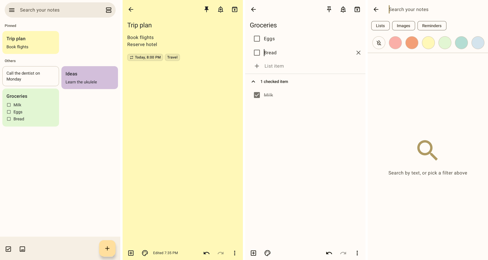
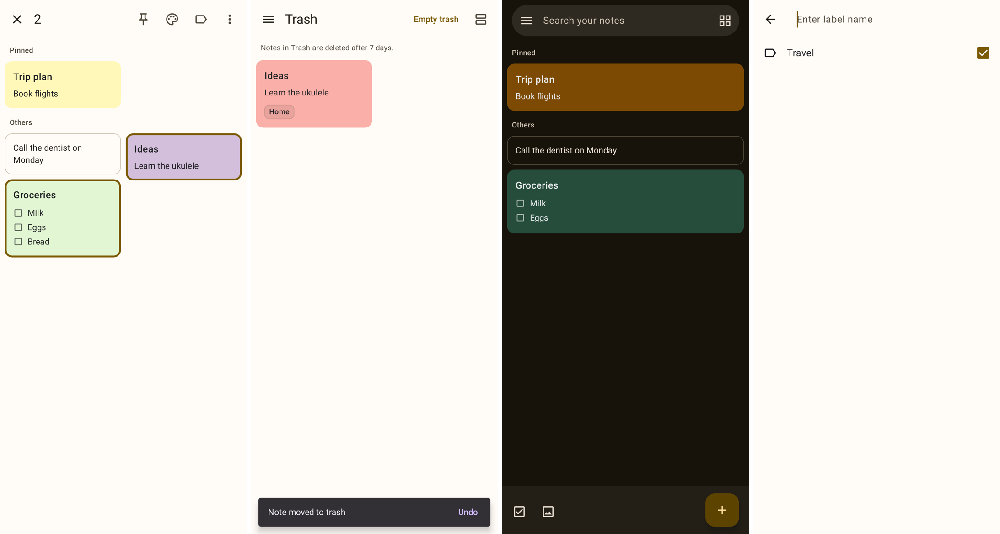

# Jotter

An offline note-taking app for Android in the style of Google Keep. Everything is stored on the
device; the app does not request the internet permission.




## Features

- **Notes and checklists** – free text or tick-box lists, convertible both ways; checked items
  collapse into their own section; Enter (or a multi-line paste) splits into new items
- **Autosave** with undo / redo; a note left empty is discarded
- **Pin, archive, trash** – trash is emptied automatically after 7 days; restore or delete forever
- **12 note colours** with light and dark variants
- **Labels** – create, rename, delete, filter by label, label several notes at once
- **Reminders** – date and time, optional daily / weekly / monthly / yearly repeat, delivered as a
  notification that opens the note; re-registered after a reboot
- **Images** – attach photos from the system photo picker (copied into app storage)
- **Search** across titles, text, list items and labels, with type / label / colour filters
- **Multi-select** – long-press, then pin, recolour, label, archive, delete or copy in bulk
- **Swipe to archive** with undo; grid or single-column layout
- **Share** a note out as text, or share text from another app into a new note
- Launcher shortcuts for *New note* and *New list*
- Light / dark / system theme, optional wallpaper colours (Android 12+)
- **Backup** – export everything (including images) to a JSON file and import it again

## Build

Requires JDK 17+ and the Android SDK (platform 35).

```
./gradlew assembleDebug          # app/build/outputs/apk/debug/app-debug.apk
./gradlew testDebugUnitTest      # unit + Robolectric UI tests
```

Minimum Android version: 8.0 (API 26).

## Structure

Kotlin, Jetpack Compose (Material 3), Room, DataStore, Navigation Compose.

```
app/src/main/java/com/jotter/notes/
  data/        Room entities + DAO, NotesRepository, settings, JSON backup
  reminders/   AlarmManager scheduling, notification + boot receivers
  ui/home/     note grid, drawer, search, multi-select
  ui/editor/   note / checklist editor
  ui/labels/   label management
  ui/settings/ settings and backup
```
