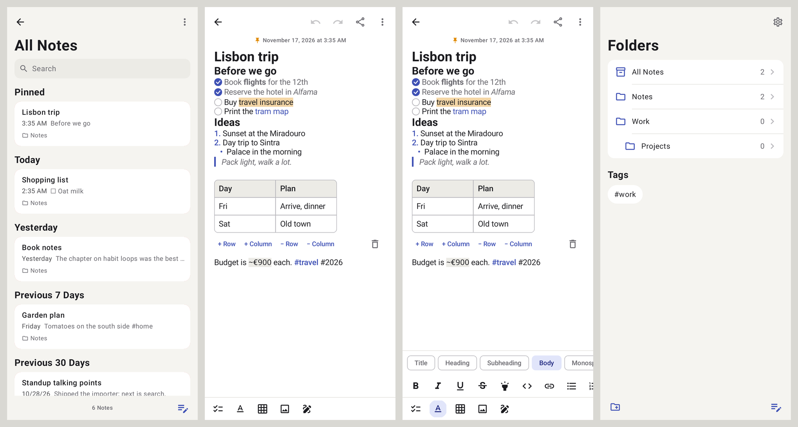
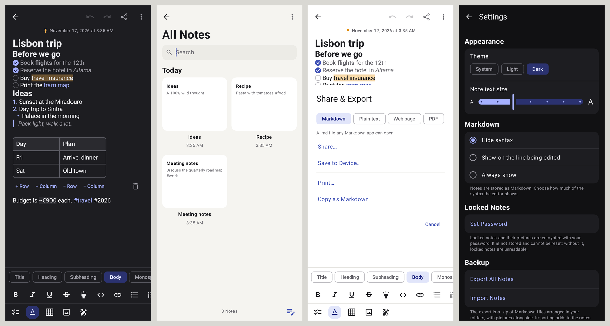

# Notes apps for Android

Two offline note-taking apps live in this repository, each its own Gradle module:

| Module | App | Style |
| --- | --- | --- |
| [`folio/`](#folio) | **Folio** | Folders, a dated note list and a rich single-page editor, in the manner of Apple's Notes. Notes are Markdown. |
| [`app/`](#jotter) | **Jotter** | Coloured cards, labels and reminders, in the manner of Google Keep. |

Both need JDK 17+ and the Android SDK (platform 35), and run on Android 8.0 (API 26) and later.

```
./gradlew :folio:assembleDebug        # folio/build/outputs/apk/debug/folio-debug.apk
./gradlew :app:assembleDebug          # app/build/outputs/apk/debug/app-debug.apk
./gradlew testDebugUnitTest           # unit + Robolectric UI tests for both
```

# Folio

An offline notes app modelled on how Apple's Notes works, with its own name and look. Everything stays on
the device: the app requests no permissions at all, not even internet access.




## Features

**Organising**
- **Folders** with sub-folders; *All Notes*; a built-in *Notes* folder; move notes and folders around
- **Note list** grouped into Pinned, Today, Yesterday, Previous 7 Days, Previous 30 Days, months and years –
  title, date and a preview line per note, with a thumbnail when the note has a picture
- **List or gallery** view; sort by date edited, date created or title
- **Pin** (swipe right), **delete** (swipe left, with undo), long-press for more, or select several notes at once
- **Recently Deleted** keeps notes for 30 days; recover them or delete them for good
- **Tags** – write `#tag` anywhere in a note and it appears in the tag browser
- **Search** across all notes

**Writing**
- The **first line is the title**; the rest is the note
- **Styles**: Title, Heading, Subheading, Body, Monospaced; **bold**, *italic*, underline, strikethrough,
  highlight, inline code, links, block quotes
- **Checklists** with tappable tick boxes, bulleted and numbered lists, indent / outdent. Enter continues a
  list, Enter on an empty item leaves it, Backspace at the start of an item removes the marker
- **Tables** you edit in place – add and remove rows and columns
- **Pictures** from the photo picker or the camera, and a **sketch pad** for drawing with a finger
- **Undo / redo**, autosave, note info (word and character counts)
- Share text from another app into a new note; launcher shortcut for *New note*
- Light / dark / system theme and adjustable text size

**Markdown**
- Notes *are* Markdown. The editor styles it live and, by default, hides the syntax so it reads like rich
  text. In Settings you can instead show the syntax on the line being edited, or always.
- Typing Markdown by hand works: `# `, `## `, `- `, `1. `, `- [ ] `, `> `, `**bold**`, `*italic*`,
  `~~strike~~`, `==highlight==`, `` `code` ``, `[text](url)`, fenced code blocks and tables.

**Locked notes**
- Lock a note behind a password. The text and its pictures are encrypted (AES-256-GCM, key derived with
  PBKDF2); only the title stays readable for the list. The key is dropped when the app leaves the screen.
- There is no password recovery, and no fingerprint unlock.

**Export and import**
- Any note: **Markdown**, **plain text**, a self-contained **web page**, or **PDF** – share it or save it to
  a file – plus **print** and *copy as Markdown*. A Markdown note with pictures is exported as a zip so the
  pictures come along.
- **Export All Notes** writes a zip of `.md` files laid out in your folders, with pictures beside them. It
  opens in any Markdown tool, and a small `folio.json` carries dates, pins and locks so Folio can restore
  everything.
- **Import** that zip, any zip of Markdown / text files (directories become folders), or individual
  `.md` / `.txt` files.

## Structure

Kotlin, Jetpack Compose (Material 3), Room, DataStore, Navigation Compose.

```
folio/src/main/java/com/folio/notes/
  markdown/    line + inline parser, live styling, smart editing, HTML rendering, text/picture/table blocks
  data/        Room entities + DAO, repository, settings, encryption, attachments, export / import
  ui/folders/  folder list and tags
  ui/notes/    note list, gallery, search, multi-select
  ui/editor/   editor, Markdown text field, tables, pictures, sketch pad, export
  ui/settings/ theme, Markdown display, password, backup
```

Tests (`folio/src/test`) cover the Markdown engine, export / import round trips, encryption and trash
housekeeping, and drive the real activity through the main flows under Robolectric.

# Jotter

An offline note-taking app for Android in the style of Google Keep. Everything is stored on the
device; the app does not request the internet permission.


## Features

- **Notes and checklists** – free text or tick-box lists, convertible both ways; checked items
  collapse into their own section; Enter (or a multi-line paste) splits into new items
- **Sub-items** – indent a list item one level under the one above it (drag it sideways, tap the
  indent button, or press Tab); ticking a parent ticks its sub-items
- **Autosave** with undo / redo; a note left empty is discarded
- **Pin, archive, trash** – trash is emptied automatically after 7 days; restore or delete forever
- **12 note colours** with light and dark variants
- **Labels** – create, rename, delete, filter by label, label several notes at once
- **Reminders** – date and time, optional daily / weekly / monthly / yearly repeat, delivered as a
  notification that opens the note; re-registered after a reboot
- **Images** – attach photos from the system photo picker (copied into app storage)
- **Search** across titles, text, list items and labels, with type / label / colour filters
- **Multi-select** – long-press, then pin, recolour, label, archive, delete or copy in bulk
- **Swipe to archive** with undo; grid or single-column layout
- **Share** a note out as text, or share text from another app into a new note
- Launcher shortcuts for *New note* and *New list*
- Light / dark / system theme, optional wallpaper colours (Android 12+)
- **Backup** – export everything (including images) to a JSON file and import it again

## Structure

Kotlin, Jetpack Compose (Material 3), Room, DataStore, Navigation Compose.

```
app/src/main/java/com/jotter/notes/
  data/        Room entities + DAO, NotesRepository, settings, JSON backup
  reminders/   AlarmManager scheduling, notification + boot receivers
  ui/home/     note grid, drawer, search, multi-select
  ui/editor/   note / checklist editor
  ui/labels/   label management
  ui/settings/ settings and backup
```
